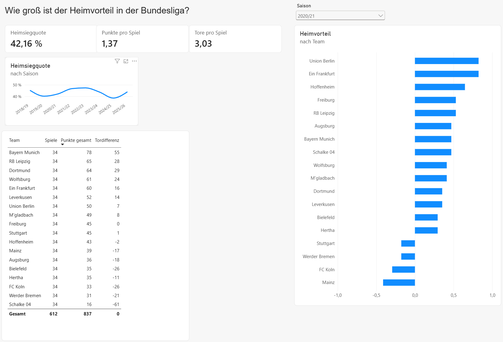
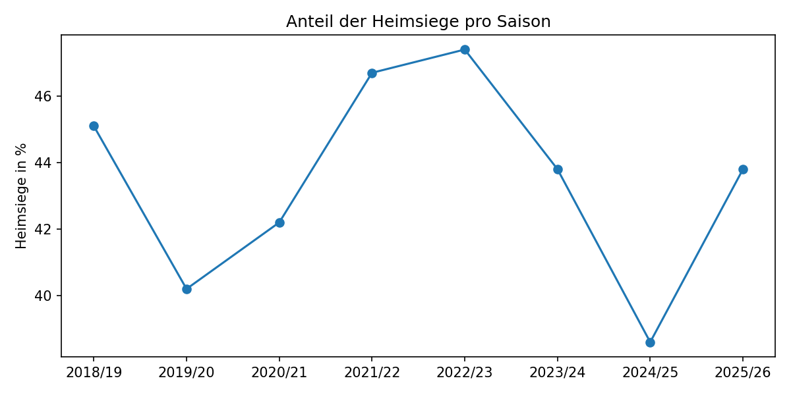

# Wie groß ist der Heimvorteil in der Bundesliga?



Eine Analyse aller 2.448 Bundesliga-Spiele der Saisons 2018/19 bis 2025/26 mit Python und Power BI. Die Leitfrage: Gewinnen Heimteams öfter, und was passierte mit dem Heimvorteil, als während der Corona-Pandemie ohne Zuschauer gespielt wurde?

## Ergebnisse

- **Heimteams gewinnen deutlich öfter.** 43,5 % aller Spiele enden mit einem Heimsieg, nur 31,9 % mit einem Auswärtssieg. 24,6 % gehen unentschieden aus.
- **Daheim gibt es mehr Punkte.** Heimteams holen im Schnitt 1,55 Punkte pro Spiel, Gastteams 1,20.
- **Ohne Zuschauer drehte sich das Verhältnis um.** In den 82 Geisterspielen nach dem Neustart im Mai/Juni 2020 gewannen Gastteams 45,1 % der Spiele, Heimteams nur 31,7 %.
- **Schon eine Saison später war der Heimvorteil fast zurück.** 2020/21 wurde meist weiter ohne Publikum gespielt, trotzdem lag die Heimsiegquote bei 42,2 %. In Phasen mit Zuschauern waren es 44,1 %.
- **Die schwächste Heimsaison war keine Corona-Saison.** 2024/25 gewannen Heimteams nur 38,6 % ihrer Spiele, weniger als in der Geistersaison 2020/21. Die Heimsiegquote schwankt von Saison zu Saison zwischen 38,6 % und 47,4 %.
- **Bochum war daheim eine andere Mannschaft.** Mit 1,32 Punkten pro Heimspiel holte der VfL doppelt so viele Punkte wie auswärts (0,66). Auch Union Berlin (+0,64) und Gladbach (+0,57) waren daheim deutlich stärker. Werder Bremen und Wolfsburg holten auswärts sogar etwas mehr Punkte als daheim (je −0,05).

| Phase | Spiele | Heimsiege | Remis | Auswärtssiege |
| --- | --- | --- | --- | --- |
| Mit Zuschauern | 2.060 | 44,1 % | 24,4 % | 31,5 % |
| Geisterspiele Mai/Juni 2020 | 82 | 31,7 % | 23,2 % | 45,1 % |
| Saison 2020/21 (meist ohne Zuschauer) | 306 | 42,2 % | 26,5 % | 31,4 % |



### Einordnung

Die Ergebnisse decken sich mit der Forschung. Dilger und Vischer (2022) fanden für die Geisterspiele am Ende der Saison 2019/20 ebenfalls, dass der übliche Heimvorteil verschwand. Eine Studie zu den Saisons 2016/17 bis 2023/24 zeigt, dass der Heimvorteil 2020/21 trotz fehlender Zuschauer wieder nah am Niveau vor Corona lag. Die Autoren erklären das damit, dass sich die Teams an leere Stadien gewöhnt hatten.

Zuschauer allein erklären den Heimvorteil also nicht. Dafür spricht auch die niedrige Heimsiegquote 2024/25, einer Saison mit vollen Stadien.

## Daten

| | |
| --- | --- |
| Quelle | [football-data.co.uk](https://www.football-data.co.uk/germanym.php) |
| Zeitraum | 8 Saisons, 2018/19 bis 2025/26 |
| Umfang | 2.448 Spiele (306 pro Saison) |
| Inhalt | Datum, Teams, Tore, Ergebnis, Schüsse, Karten |

## Vorgehen

1. **Daten laden:** Eine CSV-Datei pro Saison von football-data.co.uk, automatisch nach Saison benannt.
2. **Bereinigen:** Alle Saisons zu einer Tabelle zusammengeführt, Datumsformate korrigiert, Spalten auf Deutsch umbenannt.
3. **Umformen:** Eine zweite Tabelle mit einer Zeile pro Team und Spiel. So lassen sich Punkte und Tabellen pro Team berechnen.
4. **Kontrolle:** Die Abschlusstabellen aus meinen Daten nachgebaut und mit den offiziellen Tabellen verglichen.
5. **Analyse in Python:** Heimsiegquote, Tore und Punkte pro Spiel nach Saison und nach Phase (mit Zuschauern, Geisterspiele 2020, Saison 2020/21).
6. **Dashboard in Power BI:** Datenmodell als Sternschema, Kennzahlen in DAX, interaktive Filter.

Das Notebook mit dem gesamten Code: [bundesliga_analyse.ipynb ansehen](https://nbviewer.org/github/DEIN-NAME/bundesliga-heimvorteil/blob/main/bundesliga_analyse.ipynb)

## Dashboard

Das Power-BI-Dashboard (`dashboard.pbix`) enthält:

- **Saisonfilter**, der alle Visuals gleichzeitig filtert
- **Kennzahlen:** Heimsiegquote, Punkte pro Spiel, Tore pro Spiel
- **Liniendiagramm:** Heimsiegquote pro Saison, zeigt immer alle Saisons
- **Balkendiagramm:** Heimvorteil pro Team (Punkte pro Spiel daheim minus auswärts)
- **Tabelle** der gewählten Saison. Ein Klick auf ein Team zeigt dessen Kennzahlen

**Datenmodell:** Eine kleine Tabelle `saisons` filtert die beiden Faktentabellen `spiele` (eine Zeile pro Spiel) und `team_spiele` (eine Zeile pro Team und Spiel).

## Projektstruktur

```
bundesliga-heimvorteil/
├── bundesliga_analyse.ipynb   Analyse in Python
├── daten/
│   ├── roh/                   Originaldaten, eine Datei pro Saison
│   └── sauber/                bereinigte Tabellen für Power BI
├── dashboard.pbix             Power-BI-Dashboard
├── dashboard.png              Screenshot des Dashboards
├── heimsiege.png              Diagramm aus Python
└── README.md
```

## Selbst ausführen

1. Repository herunterladen (*Code → Download ZIP*) und entpacken.
2. Python mit pandas und matplotlib installieren, z. B. über [Anaconda](https://www.anaconda.com/download).
3. `bundesliga_analyse.ipynb` öffnen und alle Zellen ausführen. Die Daten liegen schon im Ordner `daten`.
4. Für das Dashboard `dashboard.pbix` in Power BI Desktop öffnen (nur Windows).

## Grenzen

- Die Geisterspiele im Mai/Juni 2020 umfassen nur 82 Spiele. Bei so wenigen Spielen schwanken Prozentwerte stark.
- Der Heimvorteil pro Team beruht je nach Team auf 2 bis 8 Saisons. Bei Teams mit wenigen Saisons, etwa Bochum, ist er weniger sicher.
- Zu Beginn der Saison 2020/21 waren in einigen Stadien zeitweise wenige Zuschauer zugelassen. Auch 2021/22 galten zeitweise Beschränkungen.
- Die Analyse ist beschreibend. Sie zeigt Zusammenhänge, berücksichtigt aber nicht, wie stark die jeweiligen Gegner waren.

## Nächste Schritte

- Weitere Ligen vergleichen (Premier League, La Liga, Serie A)
- Mit einem Chi-Quadrat-Test prüfen, ob die Unterschiede statistisch signifikant sind
- Die Stärke der Teams berücksichtigen, z. B. über Wettquoten oder Marktwerte

## Werkzeuge

Python (pandas, matplotlib) · Jupyter Notebook · Power BI (DAX, Power Query) · GitHub

## Quellen

- Daten: [football-data.co.uk](https://www.football-data.co.uk/)
- Dilger, A. & Vischer, L. (2022): [No Home Bias in Ghost Games](https://www.athensjournals.gr/sports/2022-9-1-1-Dilger.pdf). Athens Journal of Sports, 9(1), 9–24.
- [During and after COVID-19: What happened to the home advantage in Germany's first football division?](https://arxiv.org/abs/2411.12509) (arXiv, 2024)
